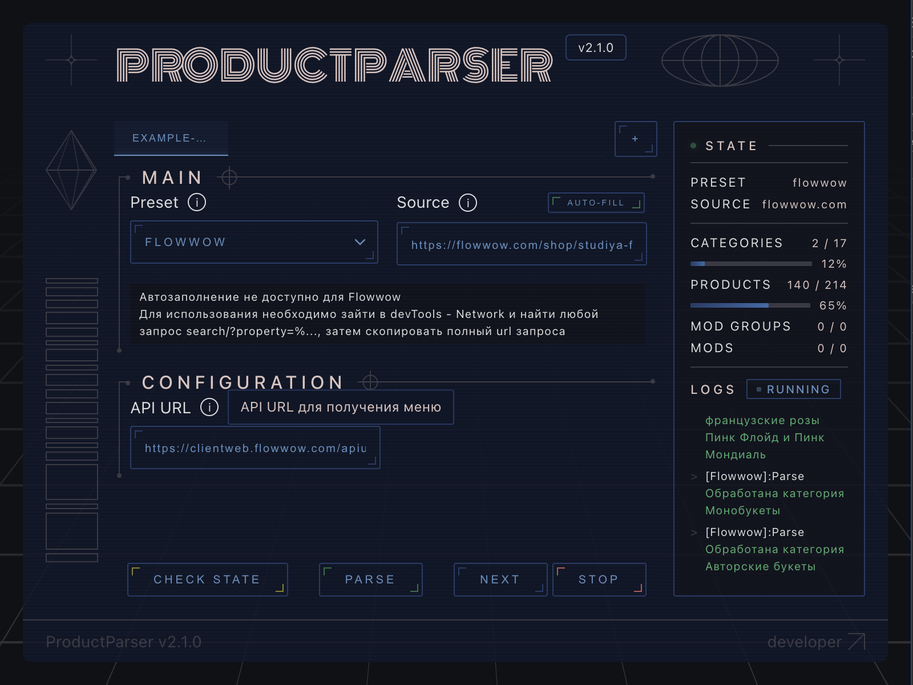
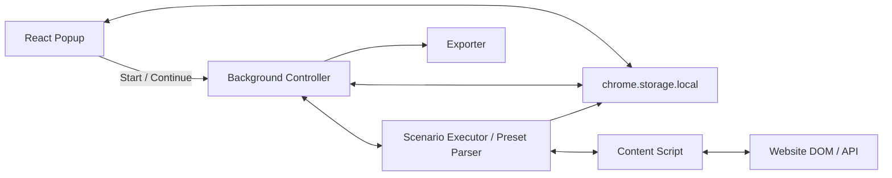
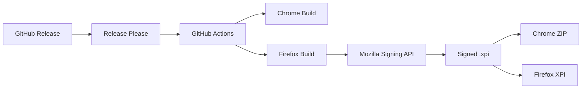

<div align="center">

<h1 align="center"> ProductParser</h1>

### Универсальное кроссбраузерное расширение для сценарной выгрузки каталогов товаров


> Сценарии • Универсальность • Экспорт

</div>

---

<p align="center">


</p>

---

## Описание

ProductParser — это расширение для браузера с открытым исходным кодом, которое помогает извлекать каталоги товаров в единый XML-формат. Его основа — **сценарный парсер**: пользователь описывает последовательность действий на странице, а расширение проходит этот сценарий, собирает категории, товары, параметры и модификаторы.

Это позволяет работать не только с заранее подготовленными интеграциями, но и с сайтами без готового парсера. Достаточно собрать сценарий из понятных шагов: открыть раздел, перебрать карточки, нажать кнопку, дождаться модального окна и собрать нужные данные.

ProductParser автоматически собирается для Google Chrome и Mozilla Firefox. Каждая новая версия сопровождается созданием готовых установочных файлов для обоих браузеров, а Firefox-версия автоматически подписывается через Mozilla Add-ons API в процессе CI/CD.

---

## Почему ProductParser?

Обычный парсер привязан к одному сайту и одной структуре страницы. ProductParser переносит логику извлечения данных в настраиваемый сценарий: сайт меняется — сценарий можно скорректировать без создания отдельного расширения.

| Задача | Как решает ProductParser |
|---|---|
| Выгрузить каталог с нового сайта | Создать сценарий из действий, циклов, ожиданий и шагов сбора данных. |
| Собрать данные из карточки и модального окна | Несколько `collect` внутри контекстного цикла дополняют один объект товара. |
| Выгрузить размеры, объёмы или порции | Вложенный цикл собирает несколько параметров одного товара. |
| Работать с динамическим интерфейсом | Стратегии контекста `Snapshot`, `Dynamic index` и `Keyed` учитывают жизненный цикл DOM. |
| Периодически обновлять каталог | Сценарий сохраняется в конфигурации и может быть запущен повторно. |

> ProductParser подходит для сайтов, где данные доступны на странице и их можно описать последовательностью действий в браузере.

---

# Функции

- Универсальный конструктор сценариев для пользовательского парсинга.
- Готовые пресеты для поддерживаемых сервисов.
- Циклы с контекстом категории, товара, группы модификаторов, модификатора и параметра товара.
- Сбор данных из списка, карточки, модального окна и вложенных элементов.
- Несколько параметров товара: размеры, веса, объёмы, порции и варианты цен.
- Действия `click` и `hover`, ожидания тайм-аута, элемента и навигации.
- Условия для ветвления сценария по наличию элемента.
- Стратегии DOM-контекста для стабильных и динамически пересоздаваемых списков.
- Динамический прогресс обработки категорий, товаров, групп модификаторов и модификаторов.
- Состояние и журнал парсинга в реальном времени.
- Пошаговый режим для настройки и отладки сценария.
- Единый формат экспорта в XML.
- Пользовательский интерфейс на React и TypeScript.
- Поддержка Google Chrome и Mozilla Firefox.
- Manifest V3, автоматические сборки, релизы и подпись Firefox-версии.

---

# Сценарный парсер

Сценарий — это дерево шагов, которое описывает поведение парсера на конкретном сайте. Он не зависит от заранее написанного API-клиента и может использовать данные, отображённые в DOM страницы.

| Шаг | Назначение |
|---|---|
| `loop` | Перебирает найденные элементы: категории, карточки, варианты, модификаторы или любые другие элементы страницы. |
| `collect` | Собирает данные сущности: категории, товара, группы модификаторов, модификатора или параметра товара. |
| `action` | Выполняет `click` или `hover` по найденному элементу. |
| `wait` | Ожидает время, появление элемента или завершение навигации. |
| `condition` | Выполняет вложенные шаги, если элемент существует или отсутствует. |

### Контекст сущности

Для цикла можно выбрать Entity context. Тогда все шаги `collect` такой же сущности внутри одной итерации объединяют данные в один объект.

```text
loop: Product
  collect: Product из карточки
    Name
    Weight

  action: открыть карточку
  wait: модальное окно

  collect: Product из модального окна
    Description
    Picture
    Price
```

В результате создаётся один товар: первые поля берутся из карточки каталога, а остальные — из открытого модального окна. Это важно для сайтов, где информация распределена между несколькими состояниями интерфейса.

### Параметры товара

Вложенные циклы позволяют собирать варианты одного товара без дубликатов: размеры, объёмы, веса, порции или другие опции с отдельной ценой.

```text
loop: Product
  collect: Product

  loop: Product parameter
    action: выбрать вариант
    wait: обновление цены
    collect: Product parameter
      Name
      Price
      Old price
      Index
```

### Стратегии DOM-контекста

Современные сайты часто перерисовывают список после клика: карточки меняют порядок, модальное окно уничтожается после закрытия, а пункты выпадающего списка появляются заново. Для таких случаев у `loop` есть выбор Context strategy.

| Стратегия | Назначение |
|---|---|
| `Snapshot` | Сохраняет исходный DOM-элемент. Подходит для стабильных карточек товаров и категорий. |
| `Dynamic index` | Находит элемент повторно по его позиции. Подходит, когда порядок списка гарантированно сохраняется. |
| `Keyed` | Находит элемент повторно по тексту или уникальному атрибуту. Подходит для размеров, порций, фильтров и выпадающих списков. |

Для динамического списка размеров можно сохранить ключ каждого варианта, открыть меню перед очередной итерацией и выбрать нужный вариант уже в новом DOM.

---

# Готовые пресеты и сценарии

Пресеты ускоряют работу с уже поддержанными сервисами, а Custom-сценарий позволяет настроить выгрузку для нового сайта без добавления отдельного модуля в исходный код.

| Сервис / режим | Статус | Настройка |
|---|---|---|
| Custom scenario | ✅ | Сценарий действий в интерфейсе расширения |
| VK | ✅ | Автозаполнение |
| Yandex Food | ✅ | Автозаполнение |
| Delivery Club | ✅ | Автозаполнение |
| Yandex Maps *(частично)* | ✅ | Автозаполнение |
| Chibbis | ✅ | Автозаполнение |
| Kuper | ✅ | Ручная настройка |
| Flowwow | ✅ | Ручная настройка |
| WhatsApp Catalog | ✅ | Ручная настройка |

---

# Интерфейс

Интерфейс намеренно избегает внешнего вида типичного расширения для браузера.

Он вдохновлён ретрофутуристическими операционными системами и инструментами разработчика, где каждое действие сценария, переход состояния и сообщение журнала отображаются в реальном времени. Сценарии раскрываются в дерево, поддерживают вложенные шаги и перетаскивание для перестроения последовательности.

<p align="center">



</p>

---

# Архитектура



### Принципы проектирования

- Всплывающее окно не содержит логики парсинга.
- Процесс парсинга контролируется фоном и продолжает работу независимо от интерфейса popup.
- Пользовательский сценарий выполняется последовательно и передаёт DOM-контекст между вложенными шагами.
- Content script работает со страницей, а background script управляет состоянием, прогрессом и экспортом.
- Общее состояние синхронизируется через `chrome.storage.local`.
- Прогресс, журналы и статусы обновляются последовательно, без потери конкурентных изменений.
- Готовые пресеты и пользовательские сценарии используют один конвейер запуска и экспорта.

---

# Установка

## Для пользователей

Загрузите последнюю сборку из **Releases**.

### Chrome

```text
Releases
    ↓
Загрузите zip архив
    ↓
chrome://extensions
    ↓
Developer Mode
    ↓
Загрузите распакованный архив
```

### Firefox

```text
Releases
    ↓
Загрузите .xpi файл
    ↓
Браузер сразу предложит установить расширение
```

Готово.

---

## Для разработчиков

Клонируйте репозиторий:

```bash
git clone https://github.com/SamuelGambino/extention-react.git
```

Установите зависимости:

```bash
npm i
```

Запустите режим разработки:

```bash
npm run dev
```

Соберите расширение для Chrome и Firefox:

```bash
npm run build
```

Отдельные сборки:

```bash
npm run build:chrome
npm run build:firefox
```

Затем загрузите собранное расширение из директории `dist`.

---

# Структура проекта

```text
background/
```

Контроллер парсинга, исполнитель сценариев, пресеты, хранилище состояния и XML-экспортер.

```text
content/
```

Content script и DOM-обработчики: поиск элементов, действия, ожидания, сбор данных и управление контекстом цикла.

```text
popup/
```

React-приложение: настройка сценария, управление вкладками, запуск выгрузки, журнал и прогресс.

```text
globalTypes/
```

Общие типы конфигурации сценария, сообщений между частями расширения и экспортируемых сущностей.

```text
scripts/
```

Регрессионные проверки поведения DOM-контекста, сценариев, состояния и формы редактора.

---

# Создание сценария

1. Откройте нужный сайт и создайте вкладку конфигурации в расширении.
2. Выберите режим `custom`.
3. Добавьте шаги `loop`, `collect`, `action`, `wait` и `condition` в порядке, соответствующем интерфейсу сайта.
4. Для циклов категорий, товаров и вариантов укажите Entity context.
5. Для динамических списков выберите подходящую Context strategy.
6. Проверьте сценарий пошаговым запуском, затем запустите полную выгрузку.
7. Экспортируйте результат в XML.

> Начинайте со сценария для одной карточки товара. Когда сбор данных работает корректно, оберните его в цикл товаров, а затем при необходимости — в цикл категорий.

---

# Создание готового пресета

Если для сервиса требуется специализированная API-интеграция, можно добавить отдельный парсер. Каждый пресет наследует один и тот же базовый класс:

```ts
class NewMarketplaceParser extends BaseParser {}
```

Создайте модуль парсера и реализуйте необходимые методы. Затем добавьте значение для вызова модуля в `background/index.ts`, тип в `globalTypes/parser_config.ts`, значение в выпадающий список `popup/Form/constants.ts` и необходимые поля конфигурации в `popup/Form/blocks/ConfigurationBlock.tsx`.

При желании можно добавить автозаполнение конфигурации в `popup/hooks/useAutoFill.ts`.

---

# Процесс выгрузки

```text
Пользователь
↓
Сценарий или пресет
↓
Циклы, действия, ожидания и сбор данных
↓
Категории, товары, параметры и модификаторы
↓
Проверка прогресса и журнал
↓
Экспорт XML
```

Парсер можно запускать целиком или пошагово. Пошаговый режим полезен для настройки новых сценариев, проверки селекторов и анализа динамического DOM.

---

# CI/CD

Каждый новый релиз автоматически проходит полный цикл публикации:

- обновление версии через Release Please;
- синхронизация версии во всех manifest-файлах;
- сборка Chrome-версии;
- сборка Firefox-версии;
- автоматическая подпись Firefox через Mozilla AMO API;
- публикация готовых артефактов на GitHub Releases.

В результате каждый релиз содержит:

- Chrome (`.zip`);
- Firefox (`.xpi`).



---

# Roadmap

- [x] Универсальный сценарный парсер.
- [x] Контекстные циклы для категорий, товаров и вариантов.
- [x] Несколько параметров товара.
- [x] Стратегии DOM-контекста для динамических интерфейсов.
- [x] Экспортер XML.
- [x] Готовые пресеты для поддерживаемых сервисов.
- [x] Кроссбраузерная поддержка Chrome / Firefox.
- [x] Автоматическая подпись Firefox.
- [x] Автоматические GitHub Releases.
- [ ] Локализация.
- [ ] Расширение набора автоматических тестов.

---

# Contributing

Pull Requests приветствуются.

Если вы хотите улучшить сценарный движок, добавить новый пресет или расширить поддержку формата экспорта, пожалуйста, сначала создайте заявку в Issues.

Форкните или дайте звезду — тоже будет приятно :)

---

# License

[MIT](./LICENSE)
